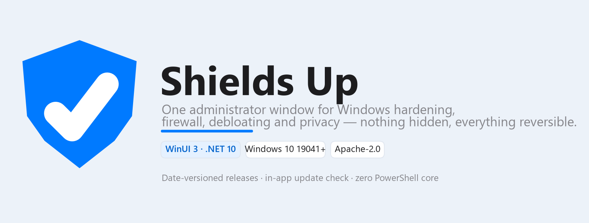
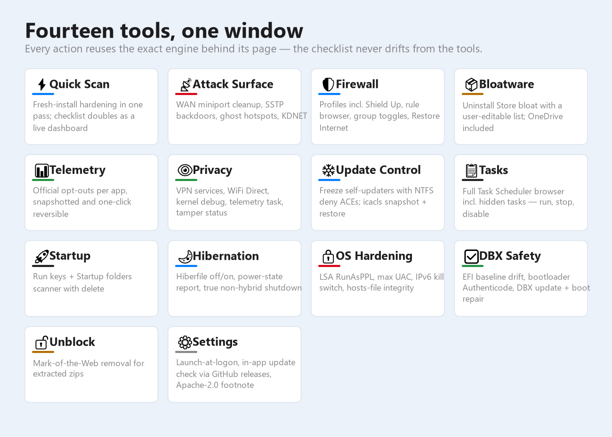
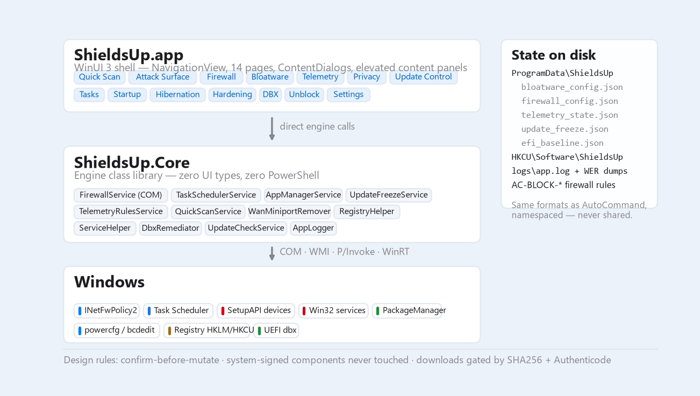

> ⚠️ **MyFirewall is deprecated — use [Shields Up](https://github.com/dparksports/shields-up) for Windows instead.** This repository (MyFirewall) is no longer maintained. Shields Up, from the same author, is where the work continues: one-click firewall presets, telemetry opt-outs, and OS hardening — every action reversible. **[GitHub repo](https://github.com/dparksports/shields-up) · [Download the latest release](https://github.com/dparksports/shields-up/releases/latest).**

# Shields Up



## Sound familiar?

You reinstall Windows 11. Before you've installed a single thing yourself, the Start
menu is full of games and apps you never asked for. Half the settings you remember
turning off are back on. And the machine you just spent an afternoon cleaning up is
quietly checking in with servers you've never heard of.

The fix was never hard — it was just *long*: uninstall this, disable that, dig through
firewall rules you can't tell apart, and do it all again after the next reinstall.

**Shields Up is that afternoon, pressed into a button.**

## Four buttons, one clean machine

**🧹 Take the junk out.** Uninstall the preinstalled apps — games, trial apps, the
ones that came back with the update. You approve the list, you can edit it, and
nothing Windows needs to run is ever on it.

**🛡 Set the firewall without becoming an expert.** You don't have to know which rule
is which — a one-click preset decides what stays open and what closes, and if
anything you need stops working, one button (**Restore Internet**) puts it all back.

**🚪 Close the doors Windows leaves open.** A stock Windows machine ships with
built-in remote-access plumbing most people will never use — VPN backdoors, hidden
hotspot adapters, kernel-debug hooks. Shields Up shows each one as a green ✓ or an
amber warning and closes them for good. And when you open Shields Up again later, it
**re-checks every door and tells you what crept back** after an update.

**📵 Silence the phone-home.** Many apps ship with usage-data collection switched on
by default — you never opted in. Shields Up flips each vendor's *own official*
opt-out switch, saves the previous setting, and then checks the app actually stopped
calling home. Want it back the way it was? One click reverts exactly.

In a hurry? **Quick Scan** is the whole ritual as a checklist — it reads your
machine's current state first, shows what's already done in green, and finishes the
rest in order.

## The part that matters: undo

Every action asks before it acts. Almost every action can be reversed. The app runs
only when you open it — no background processes, no tray icon, no auto-start unless
you ask for it. And uninstalling is deleting the folder.

## Who makes this

**Dan Park — MagicPoint.ai, California.** Shields Up grew out of
[AutoCommand](https://github.com/dparksports/autocommand-windows), an
earlier Windows security toolkit of mine, by keeping the parts
a normal PC owner actually wants and leaving the analyst tooling behind. The same
credit sits in the app, at the bottom of the Settings page.

## "Why should I run an app from a publisher I don't know?"

You shouldn't — not on faith, ours or anyone's. Everything below can be **checked**
instead of trusted:

- **Read every line.** The complete source is the
  [shields-up repository](https://github.com/dparksports/shields-up) (Apache 2.0).
  What you download is built from exactly this code.
- **Watch what it does.** No installer — unzip and run. No service, no scheduled
  task, nothing in your tray. Close it, and it isn't running.
- **Watch the network.** Exactly two kinds of connection, both only when *you* click:
  the update check talks to GitHub; the DBX Safety page downloads a Microsoft update
  when asked. No telemetry, no analytics, no accounts.
- **Verify the download.** Every release ships `SHA256SUMS.txt`
  (`certutil -hashfile <zip> SHA256` before you run anything). Settings →
  **Verify this install** does the whole check in-app: your version against the
  release, the zip's SHA256 against the published checksum, and every release
  file in your folder with the expected size. The app's own update checker
  runs the same check before trusting a download.
- **See changes before they happen.** Nothing executes without a confirmation that
  says what will change — and Windows' own signed components are locked out entirely.
- **Remove everything.** Delete the folder, delete `C:\ProgramData\ShieldsUp`, and
  there is no trace left.

**About the blue "unknown publisher" warning:** the app is not yet code-signed — a
certificate that ties the binary to a verified identity. Until releases are signed,
Windows will warn on first run. That's Windows doing its job; the list above is ours.

**Why it asks for administrator:** managing firewall rules, system services, and
device drivers requires it. A version that didn't ask couldn't do what it promises.

## What's inside



| Tool | For you, that means |
|---|---|
| ⚡ **Quick Scan** | The whole ritual as a checklist — reads your machine first, shows what's done, finishes the rest. |
| 📡 **Attack Surface** | Green/amber count of every hidden entry point, then one-click shutoff for each kind. |
| 🛡 **Firewall** | Presets, every rule in a sortable list, **Restore Internet** to undo all blocking at once. |
| 📦 **Bloatware** | Uninstall preinstalled apps against an editable list; system components never offered. |
| 📊 **Telemetry** | Each vendor's official opt-out, snapshotted and reversible, plus a "did it stop?" check. |
| 👁 **Privacy** | VPN services, hidden hotspot adapters, kernel debug, the feedback task — switchable. |
| ❄ **Update Control** | Freeze an app at its current version — it keeps working, its updater stops. |
| 📋 **Tasks** | Everything Windows has scheduled, hidden items included — run, stop, disable, delete. |
| 🚀 **Startup** | What launches at boot, from where, with delete. |
| 🌙 **Hibernation** | Remove the hiberfile (or bring it back); true full shutdown. |
| 🔒 **OS Hardening** | The big Windows security switches in plain language, plus a hosts-file check. |
| ✅ **DBX Safety** | Verifies your boot files haven't been tampered with; applies Microsoft's revocation updates. |
| 🔓 **Unblock** | Removes the "downloaded from the internet" mark that makes Windows nag on extracted files. |
| ⚙ **Settings** | Start-at-logon (optional), check for updates, version info. |

## Try it

1. Download the zip from [releases](https://github.com/dparksports/shields-up/releases/latest).
2. (Optional, encouraged) check the hash against `SHA256SUMS.txt` — or, easier:
   after your first run, press **Verify this install** in Settings and the app
   does the whole check for you.
3. Extract anywhere and run `ShieldsUp.exe`. Windows will ask for permission — see admin, above.
4. Start with **Quick Scan**, and read before you click.

**Uninstalling** = deleting the folder.

---

## For developers

The Shields Up source lives in [its own repository](https://github.com/dparksports/shields-up);
this one holds the deprecated MyFirewall.



Native WinUI 3 / Windows App SDK on .NET 10, two projects: `ShieldsUp.Core`
(the entire engine — COM/WMI/P-Invoke/WinRT, zero UI types, zero PowerShell;
native CLI tools only through one audited `ProcessRunner`) and `ShieldsUp`
(the shell + 14 pages). State is plain JSON under `C:\ProgramData\ShieldsUp`
(same file formats as AutoCommand, namespaced); sessions, navigation, and
exceptions log to `logs\app.log` with WER local dumps registered for native
crashes. The update checker compares against `releases/latest` and
SHA256-verifies downloads against `SHA256SUMS.txt`. Versions are build dates,
stamped automatically by `publish.ps1`.

```powershell
dotnet build ShieldsUp.slnx          # build
./publish.ps1                        # self-contained win-x64 folder + zip + SHA256SUMS
```

Unsigned builds may be blocked by Smart App Control; for distribution guidance
(Azure Artifact Signing, ~$9.99/mo) see the author.

## License

Apache License 2.0 — see [LICENSE](LICENSE). Shields Up is derived from AutoCommand.

---

Made with ❤️ in California · © 2026 Dan Park · MagicPoint.ai
